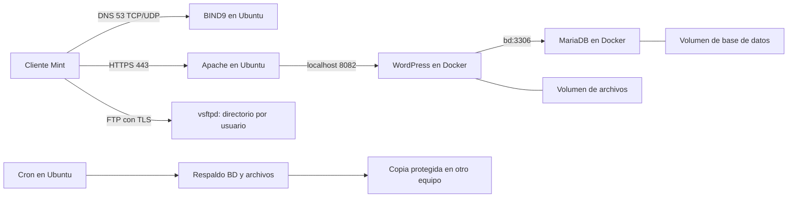

# Cooperativa Agrícola Nicoya

Proyecto del curso **EIF431O - Administración de Servidores basados en Software Libre**, Universidad Nacional, Campus Nicoya. Escenario 1: WordPress.

Un portal agrícola administrado por las oficinas de campo y la administración de la cooperativa, con publicación por roles, transferencia de archivos aislada y recuperación mediante respaldos.

**Estado al 18/10/2026: estructura documental inicial.** La arquitectura está acordada; la infraestructura del proyecto aún no ha sido instalada ni probada. Los 12 requisitos están pendientes de aceptación. El trabajo previo de los laboratorios sirve como referencia y no se presenta como evidencia del proyecto.

## Empezar aquí

1. Leer [contexto y alcance](docs/00-contexto-y-alcance.md).
2. Revisar la [matriz de requisitos y rúbrica](docs/01-requisitos.md).
3. Consultar la [arquitectura propuesta](docs/02-arquitectura.md).
4. Discutir el [plan inicial del 18 al 20 de octubre](docs/12-plan-18-20-octubre.md).
5. Completar el [inventario real](docs/inventario.md) antes de desplegar.
6. Desarrollar y comprobar la [guía de instalación](docs/03-guia-instalacion.md) por bloques.

La entrega está prevista para el **7 de noviembre de 2026**: infraestructura funcionando, documento técnico y presentación. Ver [entregables](entregables/README.md).

## Arquitectura

Dominio propuesto: `cooperativa.internal`. Ubuntu `192.168.50.1`, Mint `192.168.50.2` y puerto local `8082` son valores propuestos, pendientes de validar en el inventario. Se usará una VM dedicada, conservando los laboratorios anteriores.

## Qué contiene el repositorio

| Ruta | Propósito |
|---|---|
| [docs/](docs/README.md) | Procedimientos, requisitos, decisiones y defensa. |
| [config/](config/README.md) | Fuentes de configuración de BIND9, Apache, FTP y Cron. |
| [compose.yaml](compose.yaml) | Borrador de los dos servicios y sus volúmenes; sin despliegue validado. |
| [.env.example](.env.example) | Variables explicadas y credenciales vacías. |
| [scripts/](scripts/README.md) | Inventario de solo lectura y contratos de automatización pendientes. |
| [contenido/](contenido/README.md) | Textos, medios autorizados y registro editorial. |
| [pruebas/](pruebas/casos.md) | Pruebas permitidas/denegadas y criterios de aceptación. |
| [evidencias/](evidencias/indice.md) | Índice de evidencias por requisito, prueba y commit. |
| [entregables/](entregables/README.md) | Documento técnico y presentación para Aula Virtual. |

El primer archivo ejecutable es un inventario **de solo lectura**: `bash scripts/preflight.sh`, dentro de la VM Ubuntu. Los scripts de instalación, respaldo, restauración y verificación integral están deshabilitados con salida 2 hasta implementarlos y probarlos. No informan éxitos ficticios.

`compose.yaml` requiere variables y contraseñas locales. Su presencia no significa que el sitio esté construido: aún faltan DNS, certificado, configuración del proxy, contenido, FTP y respaldos. No ejecutar el despliegue antes de cerrar los prerrequisitos de la guía.

## Forma de trabajo

- Cada cambio se vincula a un requisito C01-C06 o E01-E06.
- Cada paso registra máquina, comandos, resultado esperado, prueba y consideraciones; usar la [plantilla de paso](docs/plantilla-paso.md).
- Todos documentan su área y un compañero reproduce sus pasos. Consultar [cómo contribuir](CONTRIBUTING.md).
- Una tarea se considera verificada cuando tiene resultado y evidencia; instalar un paquete no basta.
- Las credenciales, claves privadas, dumps y VMs se conservan fuera de Git. Ver [.gitignore](.gitignore).

## Fases propuestas

| Fechas | Resultado |
|---|---|
| 18-20 octubre | Alcance, inventario, responsables y preparación del entorno. |
| 21-24 octubre | DNS, Docker y HTTPS funcionando desde Mint. |
| 25-28 octubre | Personalización, contenido, roles y FTP. |
| 29 octubre-1 noviembre | Cron, respaldo y restauración comprobados. |
| 2-4 noviembre | Reproducción desde cero por otro integrante. |
| 5-6 noviembre | Documento, presentación y ensayo. |
| 7 noviembre | Entrega y demo en vivo. |

El [registro de decisiones, costos y licencias](docs/09-decisiones-costos-y-licencias.md) distingue obligaciones del enunciado y mejoras propuestas. Las [referencias](docs/referencias.md) identifican las fuentes académicas y técnicas.
